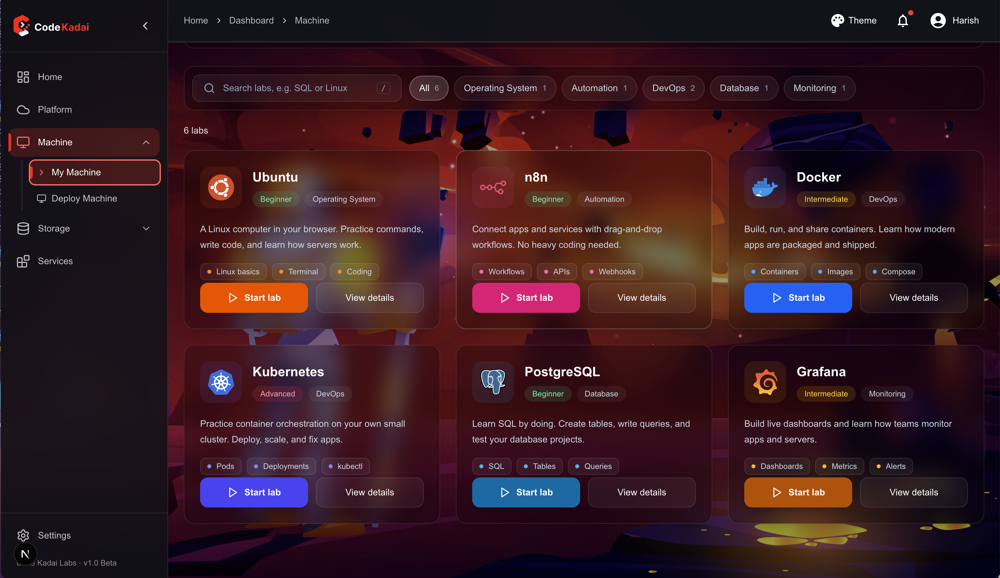

# Cloud Lab  


Cloud Lab is a **self-hosted platform** built using Docker.  
It provides users with a **Linux machine (Ubuntu) pre-configured with VS Code**, so they can directly develop software inside the lab environment.  

This platform is ideal for **colleges, edtech platforms, and training institutes**, where learners can access ready-to-use development machines.  

---

## 🚀 Tech Stack  
- **Backend:** GoLang  
- **Frontend:** Next.js  
- **API Gateway:** Apache APISIX  
- **Containerization:** Docker  
- **Cache/Queue:** Redis  
- **Database:** MongoDB  

---

## 🛠️ Services  
- **Machine (Ubuntu):** Provides a pre-configured development environment with VS Code.  
- **DBaaS (Database as a Service):** Managed MongoDB instances.  
- **Storage:** Persistent storage support for files and projects.  

---

## 📦 Getting Started  

### Prerequisites  
- Docker installed  
- Docker Compose installed  

### Setup  

```bash
# Clone the repository
git clone https://github.com/your-org/cloud-lab.git
cd cloud-lab

# Start services
docker-compose up -d
